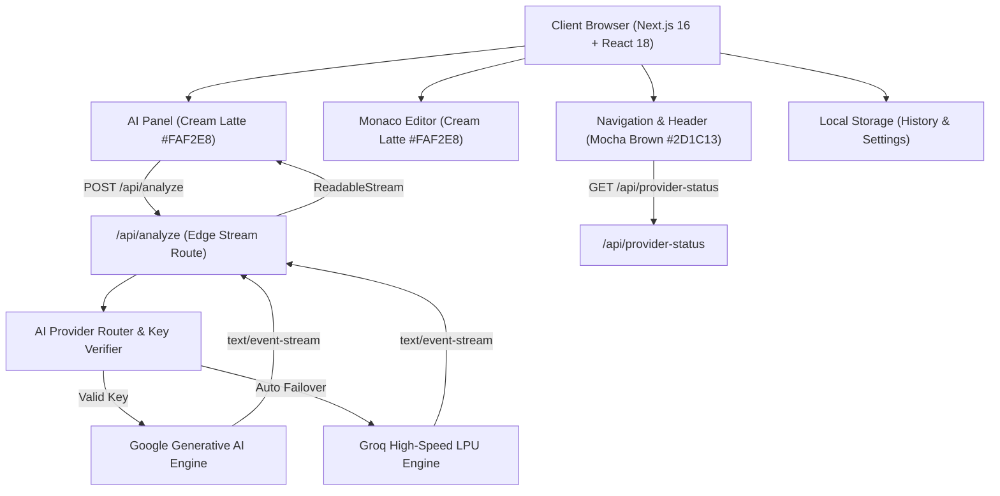

<div align="center">

# 🔍 CodeLens AI

**Intelligent Code Understanding, Algorithmic Analysis & Static Intelligence Engine**

[](https://nextjs.org/)
[](https://react.dev/)
[](https://www.typescriptlang.org/)
[](https://sdk.vercel.ai/)
[](https://microsoft.github.io/monaco-editor/)

*A minimalist developer workspace engineered with a bespoke dual-contrast palette: **Mocha Brown** (`#2D1C13`), **Cream Latte** (`#FAF2E8`), and **Caramel Bronze** (`#C89868`).*

</div>

---

## 📖 Overview

**CodeLens AI** is an AI-powered code analysis platform designed for software engineers, tech leads, and computer science students. Built on the Next.js App Router and the Vercel AI SDK, CodeLens AI performs real-time streaming AST inspection, bug auditing, Big-O complexity scorecards, code optimization, and pedagogical breakdowns.

### 🌟 Key Highlights

- **Dual-Contrast Minimalist Aesthetic**:
  - **Top Bar & Action Chrome**: *Mocha Brown* (`#2D1C13`, `#3A2419`) with *Caramel Bronze* (`#C89868`) accents.
  - **Code Editor & AI Analysis Panel**: *Cream Latte* (`#FAF2E8`) with rich *Mocha Brown* typography and syntax highlighting for soothing, zero-fatigue readability.
- **Deep Code Intelligence Modes**:
  - 📌 **Code Explanation**: Architectural walkthroughs, design patterns, and logic analysis.
  - 🚨 **Bug Audit & Fixes**: Static vulnerability scans, edge-case failure detection, and production-ready refactors.
  - 📊 **Complexity Analysis**: Time and space Big-O operational scorecards.
  - ⚡ **Performance & Clean Code**: Idiomatic modernization and benchmarking comparisons.
  - 🎓 **Concept Guide**: Beginner-friendly explanations with interactive analogies.
- **Full Monaco Editor Integration**:
  - Multi-language syntax support (TypeScript, JavaScript, Python, C++, Rust, Go, Java, SQL).
  - Code formatting, one-click snippet copying, local file upload/download, and clear actions.
  - Keyboard shortcut: <kbd>Ctrl</kbd> + <kbd>Enter</kbd> to trigger instant analysis.
- **Interactive Markdown & Stream Engine**:
  - Real-time token streaming with elapsed duration counter.
  - One-click **Apply to Editor** button embedded directly into AI code blocks.
  - Copy and Download Markdown report capabilities.
- **Persistent Local History**:
  - Automatically captures analysis runs with timestamps, language tags, and code diffs in `localStorage`.
  - Searchable by keywords, filterable by task, with single-click restore into workspace.
- **Resilient AI Routing Architecture**:
  - Multi-provider fallback engine with automatic key verification for zero-downtime streaming.
  - Fully private: underlying model names and internal provider mechanics remain hidden from the UI.

---

## 🏛️ Architecture & Workflow

### 1. High-Level System Architecture



### 2. Operational Workflow

1. **Code Ingestion**: The developer enters code in the Monaco Editor, uploads an existing source file, or selects a curated preset (e.g., QuickSort, LRU Cache, Concurrency Race Condition, Memory Leak).
2. **Task Selection**: The user selects an analysis objective (Explain, Debug, Complexity, Improve, Learn).
3. **Dispatch & Verification**: The request is validated against Zod schemas on `/api/analyze`. The server runs a non-blocking check to route requests to the active engine.
4. **Streaming Inference**: The server opens an SSE stream (`text/event-stream`). The client parses the stream chunk-by-chunk using a `TextDecoder` and `ReadableStreamDefaultReader`.
5. **Interactive Actions**: The generated markdown displays custom syntax blocks with an **Apply to Editor** button that instantly writes the improved code back to the Monaco instance.
6. **Automatic Archive**: When streaming terminates successfully, the entire session is serialized to `localStorage` for historical retrieval.

---

## 🛠️ Technology Stack

| Layer | Technologies |
|---|---|
| **Framework** | Next.js 16 (App Router, Turbopack) |
| **Language** | TypeScript 5.5 |
| **UI & Styling** | React 18, Tailwind CSS, Radix UI Primitives, Lucide Icons |
| **Editor** | Monaco Editor via `@monaco-editor/react` (Custom Theme) |
| **AI Integration** | Vercel AI SDK 7.0 (`ai`, `@ai-sdk/google`, `@ai-sdk/openai`) |
| **Markdown** | `react-markdown` with custom syntax blocks |
| **Validation** | Zod Schema Validation |

---

## 🚀 Getting Started

### Prerequisites

- Node.js 18.18+ or 20+
- npm or pnpm

### 1. Clone the Repository

```bash
git clone https://github.com/AdityaK05/CodeLensAI.git
cd CodeLensAI
```

### 2. Install Dependencies

```bash
npm install
```

### 3. Configure Environment Variables

Create a `.env.local` file in the project root:

```bash
cp .env.example .env.local
```

Populate `.env.local` with your API credentials:

```env
# Google Gemini API Key
GEMINI_API_KEY=your_gemini_api_key_here

# Groq API Key (Optional for ultra-fast failover)
GROQ_API_KEY=your_groq_api_key_here
```

> **Security Note**: Never commit `.env.local` to source control. It is explicitly ignored in `.gitignore`.

### 4. Run the Development Server

```bash
npm run dev
```

Open [http://localhost:3000](http://localhost:3000) in your browser. The application will automatically route to `/workspace`.

### 5. Build for Production

```bash
npm run build
npm start
```

---

## 📁 Project Structure

```
CodeLensAI/
├── .env.example              # Environment template
├── .gitignore                # Production ignore rules (secrets protected)
├── package.json              # Dependencies and scripts
├── next.config.mjs           # Next.js configuration
├── tailwind.config.ts        # Tailwind design tokens
├── tsconfig.json             # TypeScript configuration
├── docs/                     # Comprehensive architecture documentation
│   ├── ARCHITECTURE.md       # Detailed technical design
│   └── WORKFLOW.md           # Step-by-step data lifecycle
└── src/
    ├── app/                  # Next.js App Router
    │   ├── api/
    │   │   ├── analyze/      # Streaming analysis endpoint
    │   │   └── provider-status/ # Health & connectivity endpoint
    │   ├── globals.css       # Mocha Brown & Cream Latte tokens
    │   ├── layout.tsx        # Root layout with top Navigation
    │   ├── page.tsx          # Landing redirect
    │   ├── history/          # Saved sessions view
    │   ├── settings/         # API & editor preferences
    │   └── workspace/        # Main dual-panel IDE experience
    ├── components/
    │   ├── CodeEditor.tsx    # Cream Latte Monaco Editor
    │   ├── ExplanationPanel.tsx # Cream Latte streaming output
    │   ├── Logo.tsx          # Minimalist vector brand icon
    │   └── Navigation.tsx    # Mocha Brown top navbar
    └── lib/
        ├── ai/               # AI SDK providers, prompts & schemas
        ├── demo-fixtures.ts  # Preloaded algorithm presets
        ├── languages.ts      # Multi-language definitions
        ├── storage.ts        # LocalStorage persistence layer
        ├── theme.ts          # Color tokens
        └── types.ts          # Core TypeScript interfaces
```

---

## 🔒 Security & Privacy

- **Zero Secret Leakage**: All API keys are processed server-side in API route handlers or stored only in browser `localStorage` if client overrides are provided.
- **Strict Input Validation**: Payloads are sanitized and constrained to a 50,000-character maximum to guard against buffer exhaustion.
- **Model Privacy**: Model identifiers are kept private behind a unified "AI Engine" interface.

---

## 📄 License

Distributed under the MIT License. See `LICENSE` for more information.
