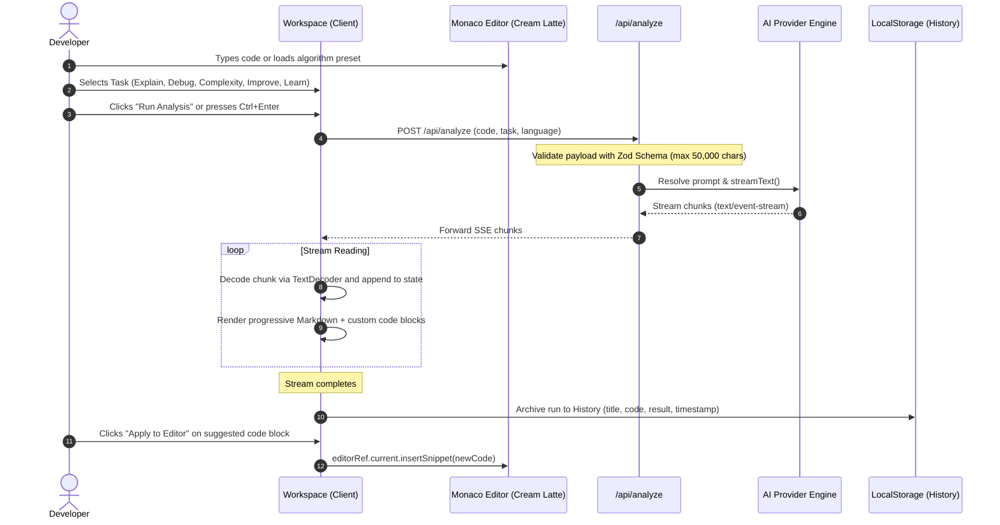

# Operational Workflow & Lifecycle

This document describes the end-to-end data lifecycle of a CodeLens AI session from code ingestion to persistent archiving.

---

## 1. Sequence Diagram

---

## 2. Phase-by-Phase Walkthrough

### Phase 1: Input & Ingestion
- **Presets**: Developers can pick from pre-configured real-world scenarios (QuickSort recursion, Concurrency race condition, LRU Cache O(1), Event listener memory leak, BST inversion).
- **File Upload**: Direct file loading with automatic file-extension-to-language mapping (`.ts`, `.py`, `.cpp`, `.rs`, `.go`, `.java`, `.sql`).
- **Formatting**: Integrated document formatting via Monaco's language service.

### Phase 2: Request Dispatch & Validation
- Sent as a JSON payload to `/api/analyze`.
- Enforces strict input validation:
  - Code non-empty and bounded to 50,000 characters.
  - Task matching the `AnalysisTaskSchema` enumeration (`explain`, `debug`, `complexity`, `improve`, `learn`).

### Phase 3: AI Inference & Streaming
- Dispatches tailored prompt templates with explicit markdown guidelines (e.g., Executive Summary, Operational Breakdown, Complexity Scorecard, Refactored Code).
- Streams tokens progressively to reduce Time-To-First-Token (TTFT) below 500ms.
- Abort controller binding: Users can click **Stop** at any moment to cancel in-flight streams.

### Phase 4: Output Rendering & Interactive Refactoring
- Formats markdown using GitHub Flavored Markdown (GFM).
- Every code block within the AI response includes:
  - One-click copy snippet button.
  - One-click **Apply to Editor** button that immediately writes the AI-generated solution back to the left Monaco canvas.

### Phase 5: Historical Archival
- Completed analyses serialize to `localStorage`.
- The **History** view allows searching previous inspections, filtering by task type, copying snippets, or re-opening any archived code directly in the active workspace.
